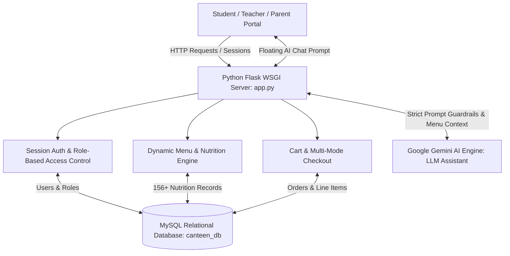
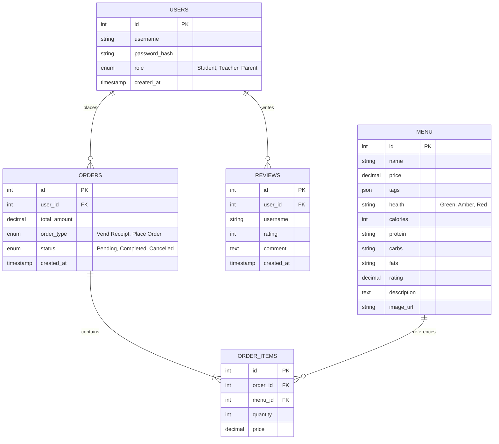

# 🍔 Cafeteria Compass

[](https://www.python.org/)
[](https://flask.palletsprojects.com/)
[](https://www.mysql.com/)
[](https://ai.google.dev/)
[](https://developer.mozilla.org/)
[](LICENSE)

> **A Smart Campus Canteen & Nutrition-Aware Food Ordering Platform**

Cafeteria Compass is a modern web application built for university and school campuses. It bridges the gap between students, parents, and cafeteria staff by providing an intuitive food ordering system enriched with nutritional data, color-coded health indicators, and an AI-powered meal assistant powered by Google Gemini.

---

## 📌 Table of Contents

- [System Architecture](#-system-architecture)
- [Database Entity-Relationship (ER) Model](#-database-entity-relationship-er-model)
- [Key Features](#-key-features)
- [Gemini AI Assistant & Prompt Guardrails](#-gemini-ai-assistant--prompt-guardrails)
- [Tech Stack](#-tech-stack)
- [Directory Structure](#-directory-structure)
- [Getting Started](#-getting-started)
  - [Prerequisites](#prerequisites)
  - [Installation & Setup](#installation--setup)
  - [Environment Configuration](#environment-configuration)
  - [Database Initialization & Seeding](#database-initialization--seeding)
  - [Running the Web Application](#running-the-web-application)
- [API & Route Reference](#-api--route-reference)
- [Default Test Credentials](#-default-test-credentials)
- [Author & License](#-author--license)

---

## 🏛️ System Architecture



---

## 🗄️ Database Entity-Relationship (ER) Model



---

## ✨ Key Features

- **🥗 Nutritional Transparency & Color-Coded Badges**:
  - Over 156+ campus-ready menu items (Momos, Biryani, Rolls, Burgers, South/North Indian Meals, Beverages).
  - Accurate breakdown of **Calories (kcal), Protein (g), Carbs (g), and Fats (g)** for every single item.
  - **Color-Coded Health Choice Badges**:
    - 🟢 **Green Choice**: Nutrient-dense, balanced meals.
    - 🟡 **Amber Choice**: Moderate nutritional profile.
    - 🔴 **Red Choice**: Indulgence treats and high-calorie snacks.
- **⚡ Fast Category Filters & Instant Search**:
  - Filter across: *Veg, Non-Veg, Beverages, Biryani, Burger, Chaat, Chinese, Combos, Dessert, Dosa, Maggi, Meals, Momo, Rolls, Snacks*.
  - Instant client-side full-text search.
- **🛒 Dynamic Cart & Multi-Mode Checkout**:
  - Real-time cart slider with live calorie & price accumulator.
  - Multi-mode ordering: standard **Place Order** or kiosk **Vend Receipt** modes.
- **🤖 Gemini AI Nutrition Assistant**:
  - Context-grounded campus AI recommending meals tailored to student budgets, dietary restrictions, and caloric goals.
  - Calculates a **Health Score (1–10)** and provides justification for dietary suggestions.
- **👥 Role-Based Portals**:
  - **Student**: Full menu access, custom cart, AI chat assistant, community reviews.
  - **Parent**: Track order history and student nutritional intakes.
  - **Teacher**: Fast campus ordering and priority receipts.
- **⭐ Community Reviews & Feedback**:
  - 1-to-5 star ratings and reviews per meal.
- **🛠️ Terminal CLI Utilities**:
  - `view_db.py`: Formatted terminal viewer for inspecting registered users, recent orders, and reviews.
  - `seed_data.py`: Seeds 156 culinary items with macros and simulated user feedback.

---

## 🤖 Gemini AI Assistant & Prompt Guardrails

The AI chatbot endpoint (`/api/chat`) interfaces with Google Gemini using explicit system prompt guardrails:
1. **Strict Menu Grounding**: Constrained strictly to active items present in the cafeteria menu database. Cannot invent fictitious food items or hallucinatory prices.
2. **Nutritional Balance Formulation**: Analyzes macro proportions ($\text{Protein} : \text{Carbs} : \text{Fats}$) against user requests (e.g. "high protein under ₹150") and calculates an aggregate **Health Score (1-10)**.
3. **Resilient Fallbacks**: If external API calls fail or latency spikes occur, the engine falls back gracefully with helpful dietary guidance.

---

## 🛠️ Tech Stack

- **Backend**: Python 3.10+, Flask, Jinja2, Werkzeug (security & password hashing)
- **Database**: MySQL, `mysql-connector-python`
- **AI & LLM**: Google Gemini API (`google-generativeai`)
- **Frontend**: Responsive HTML5, CSS3, Vanilla JavaScript, FontAwesome 6
- **Configuration**: `python-dotenv`

---

## 📁 Directory Structure

```text
canteen_app/
├── app.py              # Main Flask application & REST endpoints
├── db.py               # Resilient MySQL pool & connection handler
├── schema.sql          # Relational database schema definitions
├── setup_db.py         # Automated database & table initialization script
├── seed_data.py        # Database seeder (156 items, categories & reviews)
├── view_db.py          # Terminal CLI database inspector
├── debug_gemini.py     # Diagnostic tool for testing Gemini API keys
├── debug_rest.py       # REST endpoint smoke tester
├── requirements.txt    # Python runtime package dependencies
├── .env.example        # Environment configuration template
├── .gitignore          # Version control ignore specifications
├── static/
│   ├── css/
│   │   └── style.css   # Cafeteria design system & color palettes
│   └── js/
│       └── main.js     # Client-side cart state & AJAX handlers
└── templates/
    ├── base.html       # Base layout with navbar, search & floating AI bot
    ├── menu.html       # Filterable food item catalog
    ├── cart.html       # Slide-out cart & order summary
    ├── history.html    # Order receipt history
    ├── login.html      # Authentication portal
    └── register.html   # User registration form
```

---

## 🚀 Getting Started

### Prerequisites
- **Python**: 3.10+
- **MySQL Server**: Running locally or via cloud instance
- **Git**

### Installation & Setup

1. **Clone the repository**:
   ```bash
   git clone https://github.com/arnav-bansal-20/canteen_app.git
   cd canteen_app
   ```

2. **Create and activate virtual environment**:
   ```bash
   python3 -m venv venv
   source venv/bin/activate    # On Windows: venv\Scripts\activate
   ```

3. **Install dependencies**:
   ```bash
   pip install -r requirements.txt
   ```

### Environment Configuration

Copy `.env.example` to `.env`:
```bash
cp .env.example .env
```

Update your `.env` credentials:
```ini
GEMINI_API_KEY=your_google_gemini_api_key_here
FLASK_SECRET_KEY=your_secure_random_key
DB_HOST=localhost
DB_USER=root
DB_PASSWORD=your_mysql_password
DB_NAME=canteen_db
PORT=5001
```

### Database Initialization & Seeding

Ensure your MySQL server is running, then execute:
```bash
# 1. Initialize schema and tables
python setup_db.py

# 2. Seed 156 menu items and initial reviews
python seed_data.py
```

Inspect the database from your terminal anytime:
```bash
python view_db.py
```

### Running the Web Application

```bash
python app.py
```
Open your browser and navigate to:
**[http://127.0.0.1:5001](http://127.0.0.1:5001)**

---

## 📡 API & Route Reference

| Method | Endpoint | Description | Auth Scope |
|:---|:---|:---|:---|
| `GET` | `/` | Home redirect & splash screen | Public |
| `GET`, `POST` | `/login` | User authentication gateway | Public |
| `GET`, `POST` | `/register` | New user account creation | Public |
| `GET` | `/logout` | Clears active session | Authenticated |
| `GET` | `/menu` | Food catalog with dynamic nutritional filters | Authenticated |
| `GET` | `/cart` | Order review and summary | Authenticated |
| `POST` | `/checkout` | Dispatches orders & generates receipts | Authenticated |
| `GET` | `/history` | Historical order view | Authenticated |
| `GET` | `/api/history` | JSON stream of user order history | Authenticated |
| `GET`, `POST` | `/api/reviews` | Fetch or submit dish reviews | Authenticated |
| `POST` | `/api/chat` | AI nutrition assistant inquiry endpoint | Authenticated |

---

## 🔑 Default Test Credentials

| Role | Username | Password |
|:---|:---|:---|
| **Student** | `student` or `arnav` | `password123` |
| **Parent** | `parent` | `password123` |
| **Teacher** | `teacher` | `password123` |

*(New accounts can also be created via the registration portal).*

---

## 👨‍💻 Author

**Arnav Bansal**
- GitHub: [@arnav-bansal-20](https://github.com/arnav-bansal-20)

---

## 📄 License
This project is open-source and available under the [MIT License](LICENSE).
